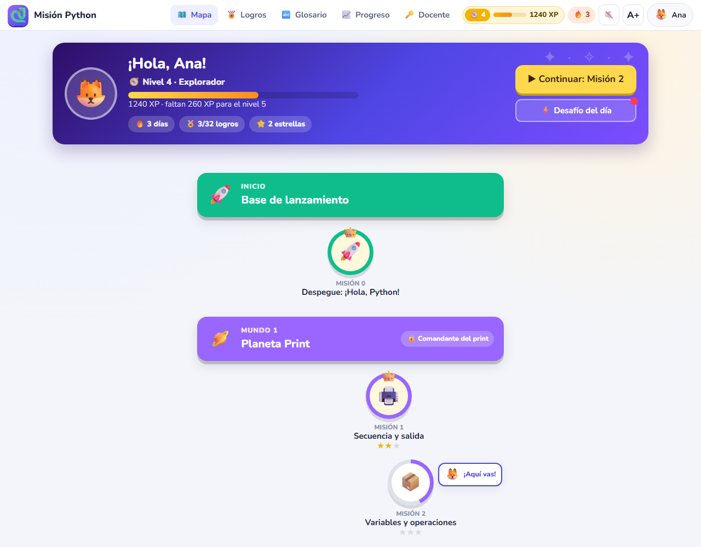
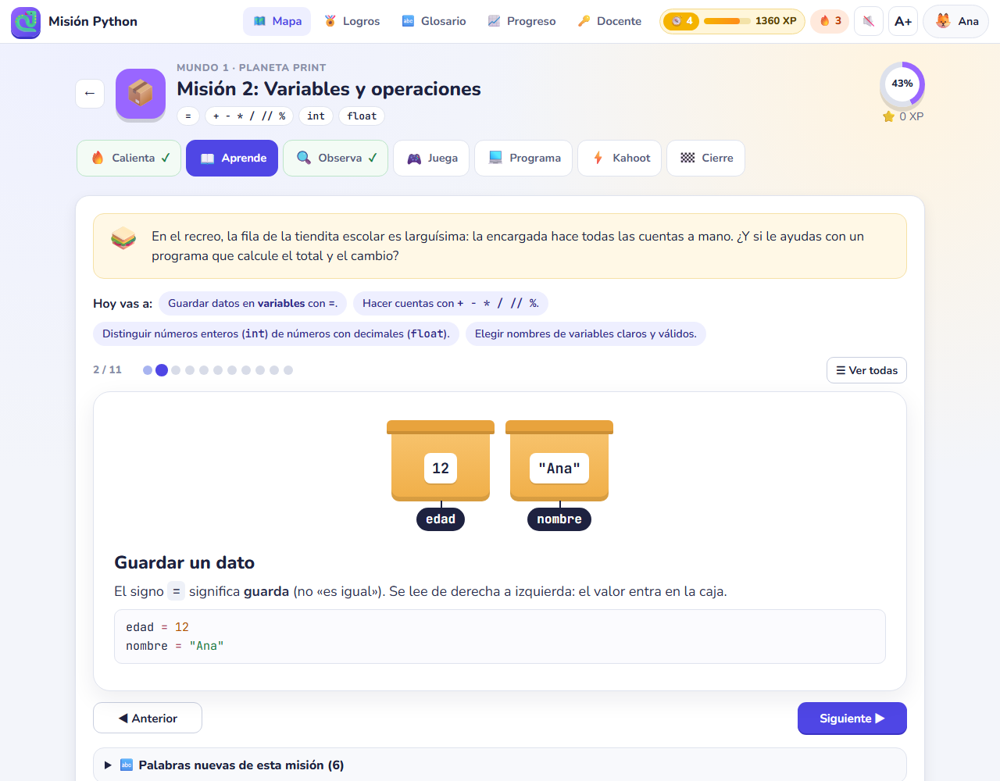
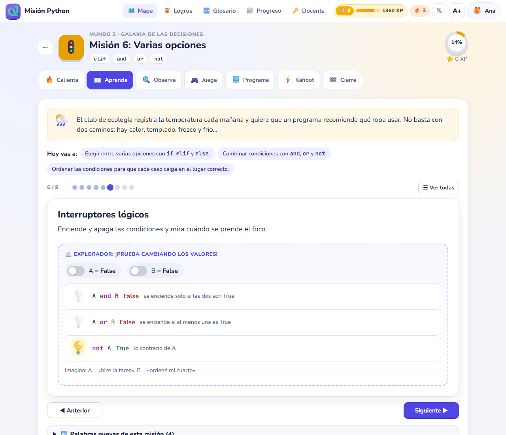
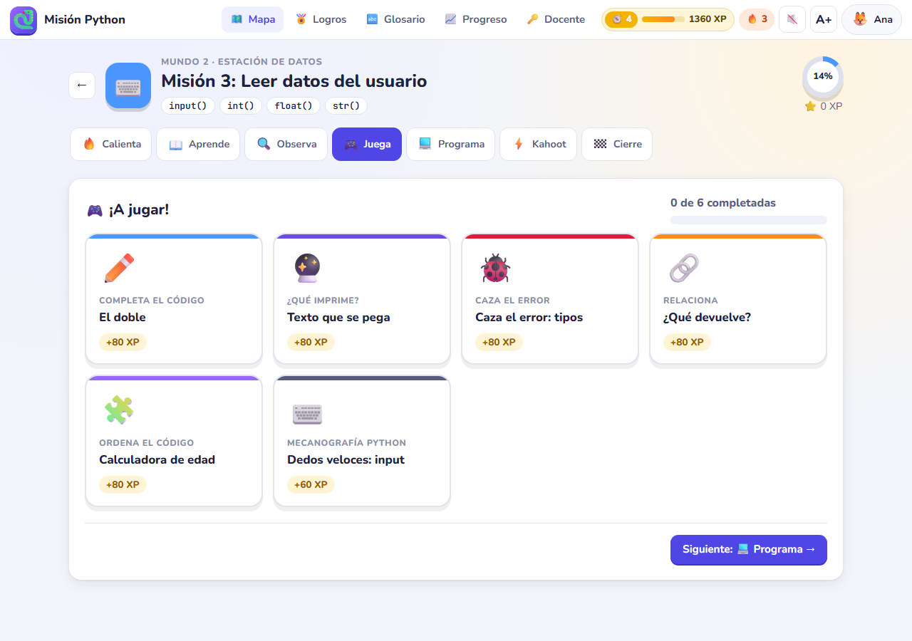
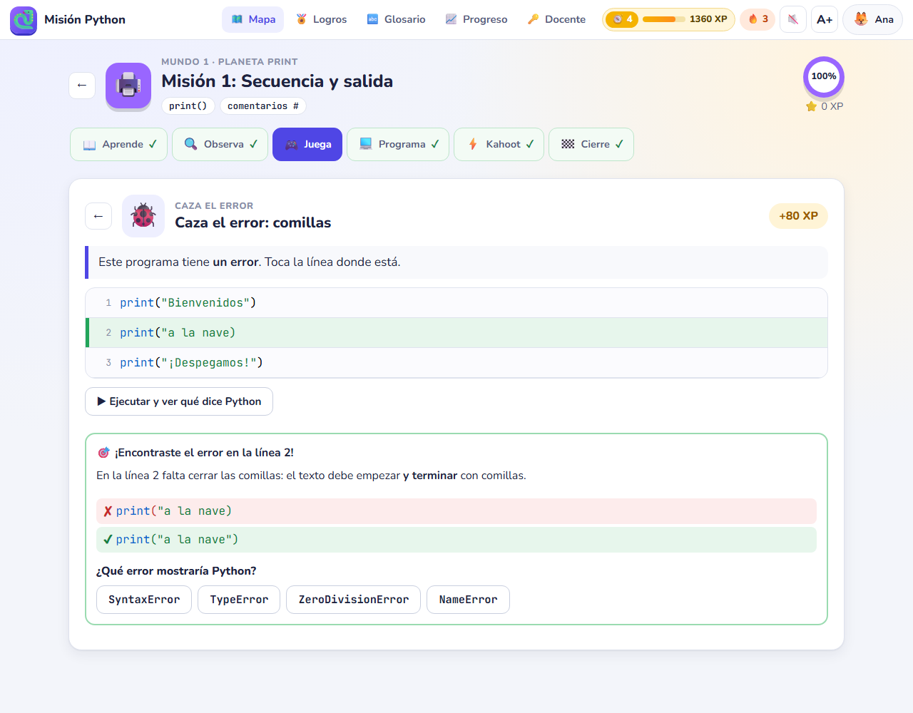
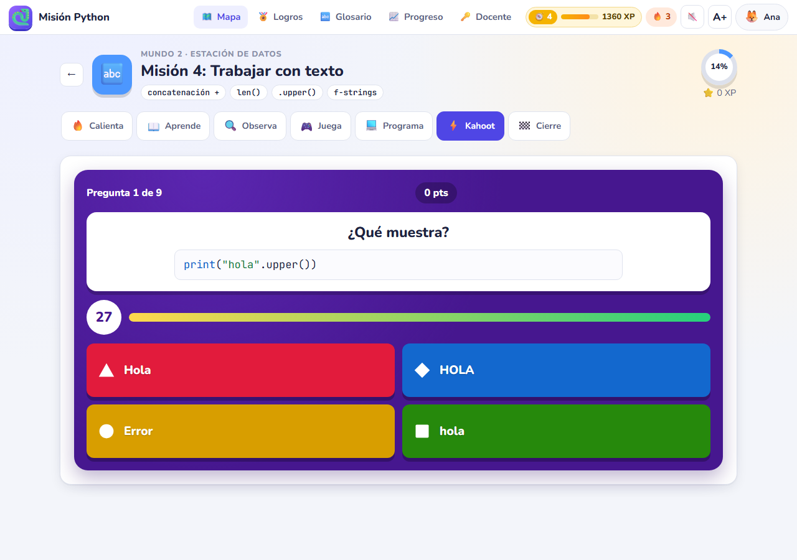
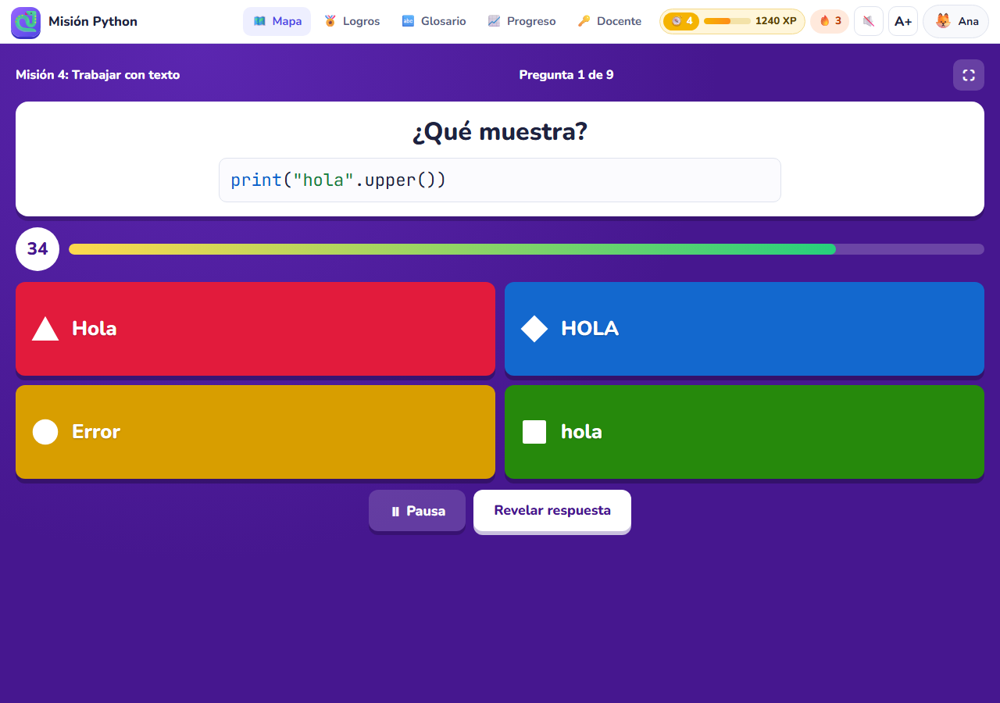
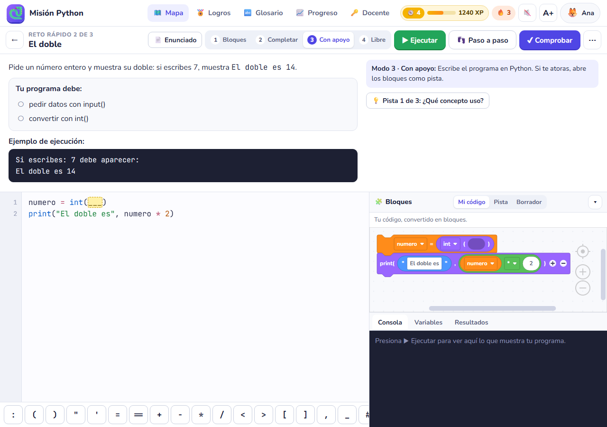
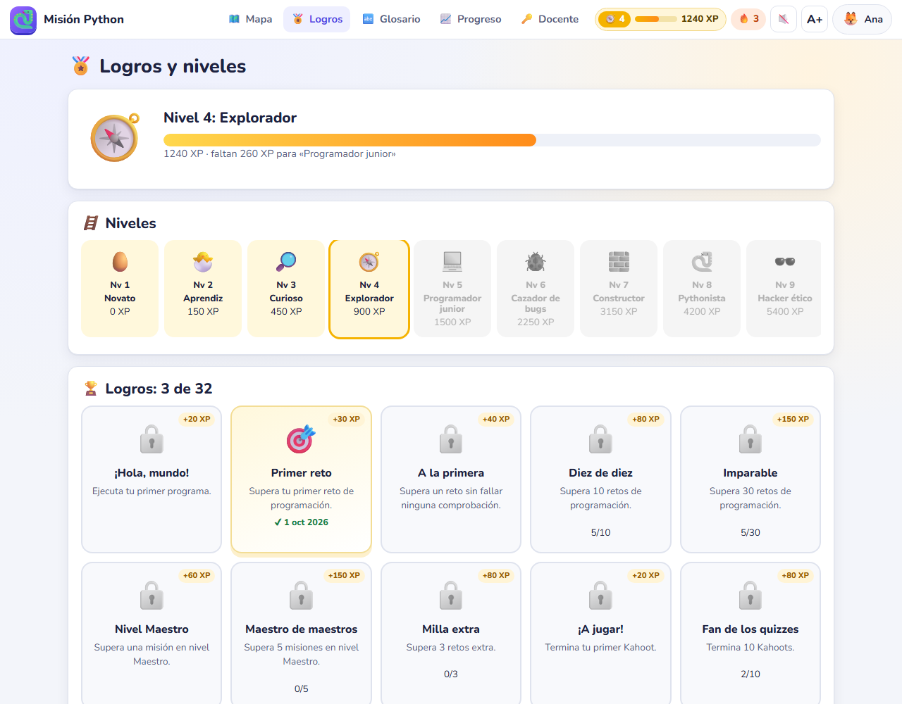
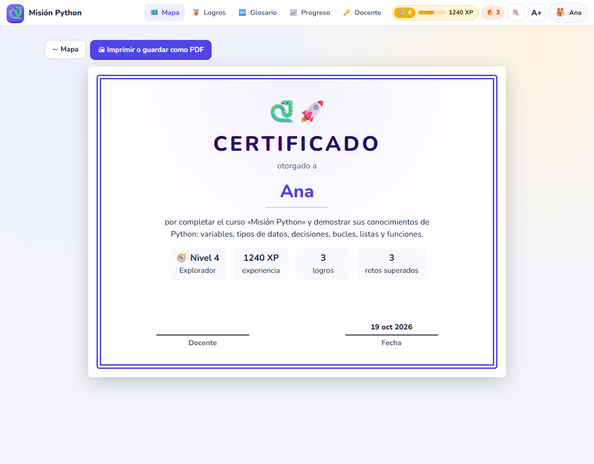

# Misión Python 🐍🚀

**▶ Abrir la plataforma: <https://carlossm17.github.io/mision-python/>**

Plataforma para aprender **Python desde cero en secundaria**, lo más interactiva posible: teoría corta y muy gráfica, laboratorios para experimentar, juegos de práctica, retos de programación, **Kahoots** (individuales o en equipos con el proyector) y gamificación con XP, niveles, logros, rachas, avatares y certificado.

Es un sitio estático: una sola página HTML que funciona en el navegador (tableta, computadora o celular) sin instalar nada, sin servidor y sin cuentas. El progreso de cada alumno se guarda en su dispositivo y se puede exportar.

> Versión derivada de «De Bloques a Python». Aquí el protagonista es Python: los alumnos escriben código desde la primera misión y los bloques quedan solo como apoyo opcional.

## Qué incluye

**17 misiones** (sesiones de unos 60 minutos) agrupadas en 8 mundos en un mapa de aventura espacial:

| Mundo | Misiones |
|---|---|
| 🚀 Base de lanzamiento | 0. Despegue: ¡Hola, Python! (incluye la prueba diagnóstica) |
| 🪐 Planeta Print | 1. Secuencia y salida · 2. Variables y operaciones |
| 🛰️ Estación de Datos | 3. Leer datos del usuario · 4. Trabajar con texto |
| 🔀 Galaxia de las Decisiones | 5. Comparar y decidir · 6. Varias opciones · 7. Mini-proyecto: tu propio quiz |
| 🌀 Nebulosa de los Bucles | 8. `for` y `range` · 9. `while` y números al azar · 10. Acumular y validar |
| ☄️ Cinturón de Listas | 11. Guardar varios datos · 12. Recorrer listas |
| 🏭 Fábrica de Funciones | 13. Crear instrucciones propias (`def`) · 14. Funciones que responden (`return`) |
| 🏆 Misión final | 15. Proyecto final · 16. Presentación, coevaluación, prueba final y certificado |

Cada misión sigue los mismos pasos: **🔥 Calienta → 📖 Aprende → 🔍 Observa → 🎮 Juega → 💻 Programa → ⚡ Kahoot → 🏁 Cierre**.

- **Teoría gráfica** (144 tarjetas en carrusel): una idea por tarjeta, con ilustraciones (cajas para las variables, balanza para comparar, escalera del `elif`, pista de carreras del `for`, estante de la lista, máquina de funciones…), 6 animaciones, ejemplos que se ejecutan con un botón, comparaciones «así sí / así no», preguntas rápidas y consejos de **Py**, la mascota.
- **15 laboratorios interactivos**: el alumno cambia valores y ve qué pasa (variables, tipos, operadores, texto, comparaciones, interruptores lógicos, `if`, `elif`, `range`, `while`, listas, recorridos, funciones e `input`).
- **84 juegos de práctica de 10 tipos**: ordena el código, caza el error, completa el código, ¿qué imprime?, traza las variables, clasifica, relaciona, verdadero o falso contra reloj, memorama y mecanografía Python.
- **Retos de programación**: 43 retos rápidos, 13 misiones con tres niveles (Explorador, Programador, Maestro), 13 retos extra, un mini-proyecto y un proyecto final con 4 opciones. Editor de Python con barra de símbolos, ejecución con `input()`, **paso a paso** con tabla de variables, casos de prueba automáticos, pistas escalonadas y errores explicados en español.
- **Kahoots**: 135 preguntas propias (8 a 10 por misión), con tiempo, puntos por rapidez y bono por racha. **Modo equipos** para proyectar en clase: los equipos responden con tarjetas de color o con los dedos y el docente marca quién acertó; marcador animado y podio. Además: calentamiento de repaso al inicio de cada misión, **desafío del día** y **Gran Kahoot** con preguntas al azar de todo el curso.
- **Gamificación**: XP por cada logro (sin repetir ganancias), 15 niveles, 32 logros, racha de días, avatares que se desbloquean al subir de nivel, sonidos y confeti (se pueden silenciar), insignia por mundo y **certificado** imprimible.
- **Para el docente**: modo docente con PIN (soluciones, planes de clase y rúbrica a la vista), Kahoot en equipos de cualquier misión, consolidación del grupo con **ranking por XP** (podio para proyectar) y tabla CSV, calificación estimada con pesos configurables, prueba diagnóstica y final, coevaluación con rúbrica.

## Capturas

| | |
|---|---|
|  |  |
| Mapa de misiones con perfil, XP, racha y desafío del día | Teoría en tarjetas con ilustraciones |
|  |  |
| Laboratorios: el alumno experimenta | Juegos de práctica de cada misión |
|  |  |
| Caza el error | Kahoot individual |
|  |  |
| Kahoot en equipos para el proyector | Taller: editor de Python, bloques de apoyo y consola |
|  |  |
| Logros y niveles | Certificado imprimible |

## Uso en clase

1. Comparte con el grupo la dirección <https://carlossm17.github.io/mision-python/>. En iPad conviene abrirla en Safari y usar **Compartir → Agregar a inicio**: funciona como una app a pantalla completa.
2. Para tenerla dentro de Google Sites: **Insertar → Insertar → Por URL**, pega la dirección y elige **Página completa** ([guía completa](docs/publicar-en-google-sites.md)). Desde ahí aparece el botón **↗** para abrirla en una pestaña propia.
3. Lee la [guía docente](docs/guia-docente.md): cómo es una misión, cómo jugar el Kahoot en equipos, cómo usar la gamificación y cómo evaluar. Los [planes de clase](docs/planes-de-clase.md) traen la secuencia de cada misión.

## Área docente

- **Modo docente** dentro de la plataforma (🔑 Docente): soluciones de cada reto, plan de clase, rúbrica y Kahoot en equipos. El PIN se define en `configuracion.json`.
- **Material privado**: las soluciones de referencia (`soluciones/*.py`) y los instrumentos de evaluación con las **claves de respuestas** de todos los Kahoots y de la prueba diagnóstica y final se generan en la carpeta hermana `../mision-python-privado/`, que **no forma parte del repositorio** (opción `"carpetaPrivada"` de `configuracion.json`).

> Como en todo sitio estático, la página trae dentro el contenido completo (incluidas las respuestas que necesita para revisar). El PIN y la carpeta privada evitan que los alumnos encuentren las soluciones por accidente, no que alguien con conocimientos técnicos las busque en el código.

## Actualizar el sitio

GitHub Pages publica `index.html` de la rama `main` (carpeta raíz). Para cambiar algo:

```
python construir.py                        # valida y prueba el contenido con Python; genera index.html y dist/
python herramientas/probar_plataforma.py   # prueba todo en un navegador real (Edge o Chrome)
git add -A
git commit -m "Describe el cambio"
git push
```

En uno o dos minutos el sitio se actualiza. El progreso de los alumnos no se pierde al actualizar: se guarda en su navegador con la misma dirección.

Todo el contenido está en `contenido/*.json` (una misión por archivo); la plataforma no se toca. La estructura de cada campo está en la [guía docente](docs/guia-docente.md#9-editar-o-agregar-contenido). Requiere Python 3.9 o posterior; la primera construcción descarga Blockly y Skulpt (versiones fijas) a `herramientas/vendor/cache/`.

`construir.py` no solo junta los archivos: **ejecuta con Python** las soluciones de los retos contra sus casos de prueba, comprueba que la respuesta de cada «¿Qué imprime?» sea la salida real, que los valores de cada «Traza» sean los verdaderos, que cada «Caza el error» falle en la línea indicada y con el tipo de error indicado, y que los ejemplos de la teoría y las preguntas de Kahoot con código muestren lo que dicen. `probar_plataforma.py` repite esas pruebas con el intérprete del navegador (Skulpt), pinta todas las pantallas, **resuelve cada uno de los 84 juegos** con sus respuestas y juega un Kahoot completo.

## Estructura

```
index.html              la plataforma (lo que publica GitHub Pages); la genera construir.py
icono-180.png           ícono para «Agregar a inicio» en iPad
configuracion.json      nombre del curso, PIN docente, dirección pública, carpeta privada y pesos de evaluación
contenido/              mundos (unidades.json), prueba de lectura y las 17 misiones (JSON)
src/                    plataforma: plantilla, estilos (estilos.css, juego.css), ícono y módulos JS
  js/51-juego.js          XP, niveles, logros, racha, avatares, sonidos y confeti
  js/62-kahoot.js         Kahoot individual y en equipos
  js/64-vistas.js         mapa, pasos de la misión, logros, perfil, docente, certificado
  js/65-actividades.js    los 10 tipos de juegos
  js/66-teoria.js         carrusel de tarjetas e ilustraciones
  js/67-exploradores.js   laboratorios interactivos
construir.py            valida, prueba y junta todo en un solo HTML; genera planes, soluciones y claves
dist/                   plataforma.html (ligera, para pegar en Google Sites) y plataforma-sin-conexion.html
docs/                   guía docente, planes de clase, publicación en Google Sites y capturas
herramientas/           banco de pruebas en navegador y capturas de pantalla
```

## Licencia y componentes

Código y contenido bajo la licencia [GNU GPL v3](LICENSE). Incluye Blockly 11.2.2 (Apache 2.0) y Skulpt, compilación del 5-mar-2026 (MIT); usa las fuentes Nunito y JetBrains Mono (OFL) desde Google Fonts.

«Kahoot!» es una marca de Kahoot! ASA; en esta guía y en el nombre del paso «Kahoot» solo se usa como nombre genérico del formato de preguntas con tiempo. La pantalla del juego se llama «PyQuiz!» y la plataforma no usa ni requiere el servicio de Kahoot.
